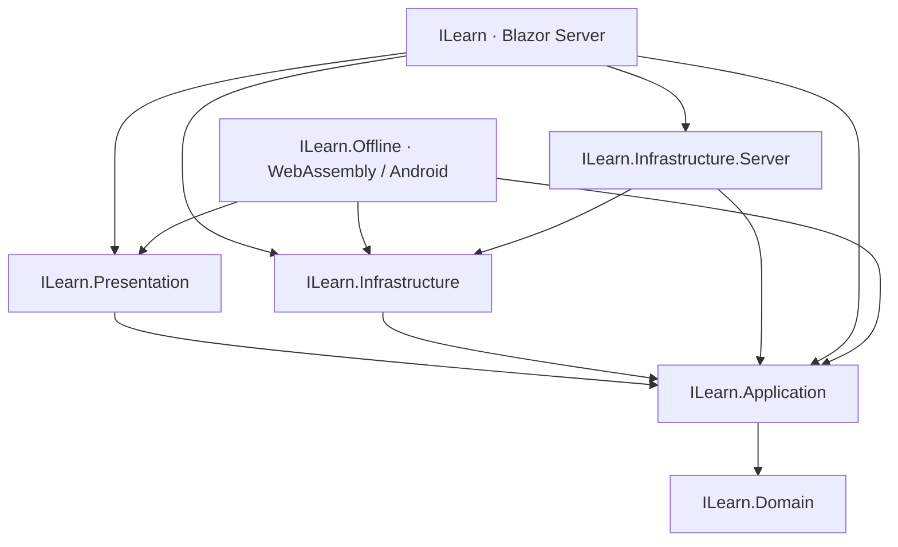

# معماری ILearn

قواعد یادگیری و قراردادها در لایه‌های داخلی قرار دارند. میزبان‌ها سرویس‌های زیرساخت را به این قراردادها متصل می‌کنند. نام namespace مؤلفه‌های منتقل‌شده حفظ شده تا مصرف‌کنندگان موجود همان نوع‌ها را استفاده کنند.



## مسئولیت‌ها

- **Domain:** مدل‌ها، قواعد بازی، امتیاز، تطبیق پاسخ مرجع، رمز و هویت؛ فقط وابسته به کتابخانه‌های استاندارد .NET.
- **Application:** قراردادهای حساب، ذخیره، محتوای آموزشی و داوری؛ عملیات `PlayerStore` و قواعد `LearningService`. این لایه از روش ذخیره و قالب JSON محتوا خبر ندارد.
- **Infrastructure:** `CurriculumData` برای خواندن و اعتبارسنجی محتوا و `Reviewer` برای HTTP و پروتکل OpenRouter؛ بدون وابستگی به ASP.NET Server یا PostgreSQL.
- **Infrastructure.Server:** آداپتورهای PostgreSQL، SMTP، schema و پاکسازی اعتبارنامه‌ها. `AddServerInfrastructure` ثبت سرویس‌ها و طول عمر آن‌ها را متمرکز می‌کند. `Curriculum` مسیر فایل را از محیط میزبان وب می‌گیرد.
- **Presentation:** صفحه‌ها و مؤلفه‌های یادگیری در یک اسمبلی Razor؛ فقط به قراردادهای Application و مدل‌های Domain دسترسی دارند. `LearningUiOptions` رفتار رابط محلی و تأخیر ذخیرهٔ خودکار را تعیین می‌کند؛ این تنظیم بخشی از قرارداد داوری نیست.
- **میزبان وب:** احراز هویت، کوکی، endpointهای HTTP، محدودسازی درخواست، صفحه‌های حساب و اتصال آداپتورها.
- **میزبان آفلاین:** هویت محلی، IndexedDB و کلید شخصی مدل. Android خروجی همین میزبان را بسته‌بندی می‌کند.

## قواعد تغییر

محتوای مشترک از `ICurriculum` با فهرست‌های فقط‌خواندنی مصرف می‌شود. مدل‌ها و شناسه‌های محتوا، قالب سیو، تراکنش‌های حساب و قواعد امتیازدهی در این ریفکتور تغییر نکرده‌اند. فقط فهرست‌های سطح بالای curriculum فقط‌خواندنی‌اند؛ مدل‌های محتوا و پیشرفت همچنان ساختار فعلی خود را دارند.

برای اشتراک کد اجرایی و Razor از `ProjectReference` استفاده می‌شود. کامپایل فایل منبع از پروژهٔ دیگر مجاز نیست. فایل‌های ثابت و داده‌های آموزشی وب همچنان به‌صورت resource/content در خروجی آفلاین بسته‌بندی می‌شوند.

مسیرهای مشترک در `ILearn.Presentation` تعریف شده‌اند. Router هر دو میزبان باید اسمبلی آن را در `AdditionalAssemblies` داشته باشد. وب همین اسمبلی را در `MapRazorComponents().AddAdditionalAssemblies(...)` نیز ثبت می‌کند تا مسیرهای اولیهٔ HTTP پیدا شوند. مجوزهای وب و `AuthorizeRouteView` حفظ شده‌اند؛ آفلاین از `RouteView` و هویت محلی استفاده می‌کند.

## بررسی

```powershell
dotnet build ILearn.slnx -m:1
dotnet test ILearn.Tests/ILearn.Tests.csproj --no-build
```

اجرای تست‌ها به runtime حداقل .NET 10.0.14 نیاز دارد. `ArchitectureTests` جهت ارجاع پروژه‌ها، استقلال لایه‌های داخلی، نبود وابستگی سرور در پروژه‌های مرورگر و نبود لینک به فایل‌های منبع خارجی را بررسی می‌کند. `ServiceRegistrationTests` نیز composition root وب را بدون اتصال به دیتابیس راه می‌اندازد و قابلیت resolve سرویس‌ها را کنترل می‌کند.

آزمون مرورگر آفلاین می‌تواند خروجی publish جداگانه را بخواند:

```powershell
dotnet publish ILearn.Offline/ILearn.Offline.csproj -c Release -o artifacts/architecture-offline
$env:ILEARN_OFFLINE_ROOT = (Resolve-Path artifacts/architecture-offline/wwwroot).Path
node verification/focused-ui.cjs
node verification/focused-web.cjs
```

آزمون وب از پایگاه QA مجزا و SMTP و مدل محلی استفاده می‌کند. این فرمان‌ها سرویس منتشرشده و بستهٔ Android نصب‌شده را جایگزین نمی‌کنند.
